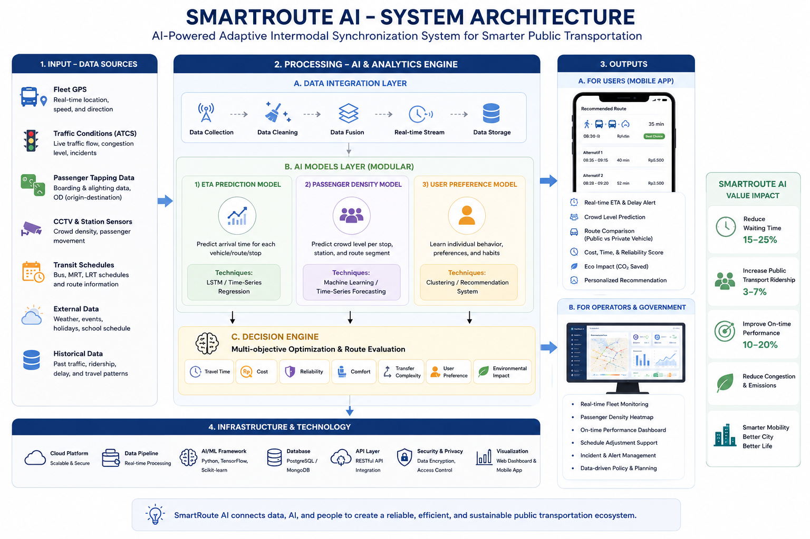

# SmartRoute AI

Perencana perjalanan transportasi umum Jabodetabek — TransJakarta, KRL, MRT,
dan LRT dalam satu rute — dengan informasi kepadatan dari laporan penumpang
dan computer vision, estimasi keandalan, serta asisten AI.



## Isi repo

| Folder | Isi | Stack | Port |
|---|---|---|---|
| [`smartroute/`](smartroute/) | Aplikasi mobile penumpang: cari rute, navigasi, peta kepadatan, halte terdekat, asisten AI | Expo (React Native), NativeWind | 8081 (Metro) |
| [`backend/backend-skeleton/`](backend/backend-skeleton/) | API utama aplikasi: rute multimoda, skor rekomendasi, laporan kepadatan, asisten AI (OpenRouter) | Express + TypeScript | 3000 |
| [`backend/otp2-setup/`](backend/otp2-setup/) | Mesin routing OpenTripPlanner 2 dengan feed GTFS TransJakarta, KRL, MRT, LRT + peta OSM | Docker | 8080 |
| [`smartroute-dashboard/`](smartroute-dashboard/) | Dashboard operator: peta stasiun 3D, status armada, stasiun yang ditandai | React + Vite | 5173 |
| [`smartroute-backend/`](smartroute-backend/) | API dashboard: login admin, stasiun, armada, penanda | Express + PostgreSQL | 5000 |
| [`testing-1/`](testing-1/) | Model 0: deteksi & penghitungan orang dari video untuk estimasi kepadatan | Python, YOLO11 + ByteTrack | — |
| [`task/`](task/), `backend/task/` | Dokumen task, laporan verifikasi, dan runbook demo | Markdown | — |
| [`data/`](data/), [`Data KRL JABODETABEK/`](<Data KRL JABODETABEK/>) | Data sumber jadwal & tarif | xlsx, JSON | — |
| [`docs/`](docs/) | Gambar arsitektur, mockup, dan simulasi | — | — |

## Menjalankan

Prasyarat: Node.js 20+, Docker Desktop, Python 3.10+ (untuk Model 0), dan
PostgreSQL (hanya untuk dashboard).

**1. Mesin routing (OTP2).** Graph tidak disimpan di git (~200 MB per graph),
jadi bangun sekali dari GTFS + OSM — langkah lengkapnya di
[`backend/otp2-setup/README.md`](backend/otp2-setup/README.md):

```bash
cd backend/otp2-setup
./scripts/clip-osm.sh       # unduh & potong peta OSM Jabodetabek
./scripts/build-graph.sh    # bangun data/graph.obj
./scripts/serve.sh          # OTP2 di http://localhost:8080
```

Versi PowerShell tersedia untuk setiap skrip (`*.ps1`).

**2. API utama.**

```bash
cd backend/backend-skeleton
cp .env.example .env        # isi OPENROUTER_API_KEY
npm install
npm run dev                 # http://localhost:3000
```

**3. Aplikasi mobile.** `EXPO_PUBLIC_API_BASE_URL` harus menunjuk ke API
utama yang bisa dijangkau dari HP (IP LAN laptop atau tunnel), bukan
`localhost`:

```bash
cd smartroute
npm install
EXPO_PUBLIC_API_BASE_URL=http://<ip-laptop>:3000 npx expo start
```

**4. Dashboard (opsional).** Pulihkan database dari dump, isi `.env`
(`DB_HOST`, `DB_PORT`, `DB_USER`, `DB_PASSWORD`, `DB_NAME`, `JWT_SECRET`),
lalu jalankan API dan dashboard:

```bash
cd smartroute-backend
createdb smartroute
pg_restore -d smartroute src/db/dump-smartroute-202609232052.sql
npm install && npm run dev  # http://localhost:5000

cd ../smartroute-dashboard
npm install && npm run dev  # http://localhost:5173
```

**5. Model 0 (opsional).** Lihat
[`testing-1/task-01-model0-mini/README.md`](testing-1/task-01-model0-mini/README.md).
Bobot `yolo11n.pt` diunduh otomatis oleh Ultralytics saat pertama dijalankan.

## Menyalakan demo

Urutan setelah laptop menyala (semua mati saat restart). Windows PowerShell;
alur, angka, dan daftar periksa ada di
[`task/Runbook_Demo_Investor.md`](task/Runbook_Demo_Investor.md).

1. **Docker Desktop**, lalu OTP2 (graph sudah dibangun):
   `cd backend/otp2-setup; docker compose up -d`. Tunggu graph termuat
   (`http://localhost:8080` menjawab).
2. **Backend:** `cd backend/backend-skeleton; npm run dev` (port 3000).
   Kunci di `.env`: `OPENROUTER_API_KEY` (TOTO), `IQAIR_API_KEY` (opsional,
   kartu udara), `DEMO_TUNNEL_URL`.
3. **Tunnel** ke port 3000 dengan URL tetap yang sama dengan `DEMO_TUNNEL_URL`:
   `ngrok http 3000 --url <DEMO_TUNNEL_URL>`.
4. **Metro untuk HP** (Dev Client sudah terpasang, tanpa rebuild):
   ```powershell
   cd smartroute
   $env:EXPO_PUBLIC_API_BASE_URL = '<DEMO_TUNNEL_URL>'; npx expo start --tunnel --dev-client
   ```
   Web lokal: `$env:EXPO_PUBLIC_API_BASE_URL = 'http://localhost:3000'; npx expo start --web`.
5. **Preflight** (setelah gladi terakhir, restart backend dulu supaya laporan
   kepadatan sisa uji hilang):
   ```powershell
   cd backend/backend-skeleton; npm run preflight
   ```
   Tabel PASS/WARN/FAIL: layanan lokal & tunnel, OTP2, pemanasan rute
   S1/S2/S3, akun demo, TOTO, kualitas udara, dan cadangan database. Target:
   tanpa FAIL. Akun demo dibuat sekali dengan `npm run seed:demo`.

Restart backend yang aman (hanya port 3000, bukan Metro/OTP2):
`(Get-NetTCPConnection -LocalPort 3000 -State Listen).OwningProcess | % { taskkill /PID $_ /T /F }`
lalu `npm run dev`.

## Yang sengaja tidak ada di repo

- **Rahasia** (`.env`): kunci OpenRouter, password database, JWT secret. Salin
  dari `.env.example` dan isi sendiri.
- **Graph OTP2 dan ekstrak OSM** (`*.obj`, `*.pbf`): ratusan MB, dibangun
  ulang dengan skrip di atas.
- **Video demo dan hasil visual Model 0**, serta dataset ShanghaiTech
  (lihat `testing-1/task-02-validasi-shanghaitech/DOWNLOAD_SHANGHAITECH.md`).
- **PDF referensi** (jurnal, publikasi BPS, data Dishub): karya pihak ketiga.

## Sumber data

- Jadwal & tarif KRL Commuter Line: [kci.id](https://kci.id), lewat dataset
  di `Data KRL JABODETABEK/` (CC BY-SA 4.0).
- Jadwal & tarif MRT Jakarta: [jakartamrt.co.id](https://jakartamrt.co.id).
- Jadwal & tarif LRT Jabodebek: sumber resmi operator (lihat
  `backend/otp2-krl-experiment/data/lrt_source/`).
- Feed GTFS TransJakarta: lihat `backend/otp2-setup/scripts/download-gtfs.*`.
- Data jalan: © kontributor [OpenStreetMap](https://www.openstreetmap.org/copyright) (ODbL).

## Tim

- Muhammad Khalifa ([@lippbyte](https://github.com/lippbyte)) — backend
  routing & AI, integrasi aplikasi
- [@inouerakan](https://github.com/inouerakan) — aplikasi mobile, dashboard,
  dan API dashboard
- Bayu — spreadsheet data sumber (`data/sources/bayu/`)
